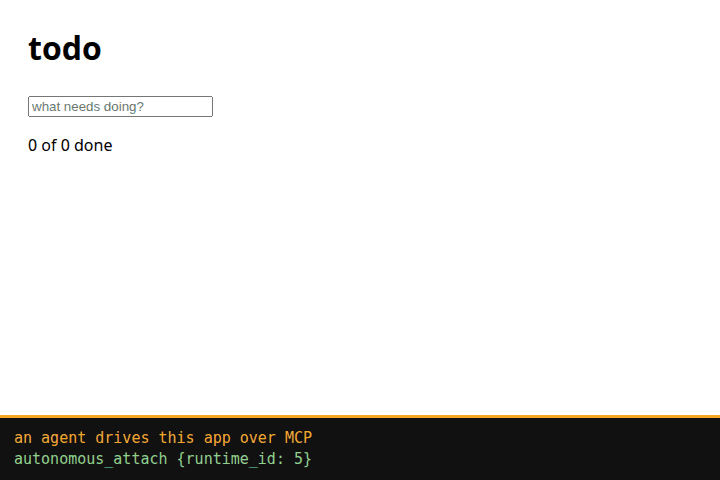

<p align="center">
  <picture>
    <source media="(prefers-color-scheme: dark)" srcset="doc/img/hero-dark.png">
    
  </picture>
</p>

<!-- hive-badges -->

[](https://github.com/hive-agi/autonomous/actions/workflows/staging-gate.yml)
[](https://github.com/hive-agi/autonomous/actions/workflows/release.yml)
[](https://clojars.org/io.github.hive-agi/autonomous)
[](https://opensource.org/licenses/MIT)

<!-- /hive-badges -->

Make a running application agent-operable. The app declares, inside the
running program, what an agent may **do** (tools) and **see** (resources), in
its own vocabulary. A bridge serves that surface over MCP, so any MCP client
(Claude Code, a hive swarm, your own agent) can drive the app: locally over
stdio, or remotely over authenticated HTTP. The runtime is `.cljc` with a
re-frame adapter; the bridge runs on the JVM, babashka and ClojureWasm.

## Why

Agents that drive a UI through screenshots and clicks are slow and brittle,
and they see none of the app's own meaning. Agents that get a raw REPL can do
anything, which is too much. `autonomous` sits between the two. The app names
the operations it supports, with malli schemas, scopes and descriptions. An
agent calls them like any MCP tool, and the call runs through the same code
path a human click does (for re-frame: a real `dispatch-sync` through
interceptors and effects). Every call is
attributed to an actor and recorded, so several agents can share one app.

## Quickstart

The repository ships a re-frame todo app (`example/`). Run it and drive it
from Claude Code. You need the Clojure CLI, Node.js and npm.

```sh
git clone https://github.com/hive-agi/autonomous && cd autonomous
npm install
clojure -M:cljs -m shadow.cljs.devtools.cli watch app
```

Open <http://localhost:8280/>. The page loads the app and its agent surface.
In another terminal, register the bridge with your MCP client:

```sh
claude mcp add todo -- clojure \
  -Sdeps '{:deps {io.github.hive-agi/autonomous {:mvn/version "0.1.2"}}}' \
  -M -m autonomous.cli serve --dir "$PWD" --build app
```

The agent now sees `todo_add`, `todo_toggle`, `todos_visible` and the other
app tools, plus the `autonomous_*` session tools. Ask it to add a todo and
watch the page change. `--build app` matters here: without it the bridge
picks the first build in `shadow-cljs.edn`, which is `:test`.

### One command: `bb demo`

```sh
bb demo
```



`bb demo` starts shadow-cljs (`watch app`) on ports next to the defaults
(nREPL 7889, dev-http 8281, so your own watch on 7888/8280 keeps running),
starts the bridge over loopback HTTP (`http://127.0.0.1:7777/mcp`, no
token), and opens the page. With no display, it prints the URL instead. A
scripted agent (`example/demo-script.json`) then makes one MCP call every
1.5 s: it adds, ticks, filters and removes todos, and sends one empty todo
that the malli schema refuses. The demo also prints the commands that
point Claude Code or a hive ling at the same endpoint. Ctrl-C stops
everything it started.

| flag | effect |
|---|---|
| `--no-script` | no scripted agent: bring your own |
| `--no-open` | print the URL, do not open a browser |
| `--exit` | stop once the script has run |
| `--step-ms N` | pause between scripted calls |
| `--record OUT.gif` | record the GIF above with headless Playwright ([doc/demo/record.py](doc/demo/record.py), needs `pip install playwright` and ffmpeg) |

Your own app needs two things. First, the library on its classpath (malli
comes along; re-frame and datahike stay your choice):

```clojure no-run
;; deps.edn
io.github.hive-agi/autonomous {:mvn/version "0.1.2"}
```

Second, a namespace that registers its surface, called from your init. This
is the example's, shortened:

```clojure no-run
(ns todo.agentic
  (:require [autonomous.core :as a]
            [autonomous.re-frame :as arf]))

(defn install! [dev?]
  (a/set-app-info! {:name "todo"
                    :description "A todo list. Add with todo_add, read todos_visible."})
  (arf/reg-event-tool :todo/add
    {:description "Add a todo item. Answers the visible todos."
     :input [:map [:text [:string {:min 1 :max 200}]]]
     :args->event (fn [{:keys [text]}] [:todo/add text])
     :result-sub [:todos/visible]})
  (arf/reg-sub-tool :todos/visible
    {:description "The todos currently visible under the active filter."})
  (arf/expose-db! {:paths [[:todos] [:filter]]})
  (arf/observe-events! {:payloads? true})
  (when dev? (arf/install-dev-tools!)))
```

## Core concepts

- **Tool**: something an agent may do. A name, a description, a malli input
  schema (published as JSON Schema), required scopes, and a handler.
- **Resource**: something an agent may read, at a URI.
- **Scope**: a permission keyword. `:read`, `:write`, `:admin` (covers every
  scope) or any keyword the app invents. A request with no scopes gets
  `#{:read}`.
- **Runtime**: one running program that carries the registry: a browser tab, a
  node process, a JVM.
- **Session**: one agent's conversation with the bridge: its actor, its
  scopes and the runtime it is attached to.
- **Lease**: one actor's exclusive right to write to a runtime for a while.
  Reads stay open to everyone.
- **Journal and ledger**: each runtime keeps a bounded journal of calls,
  leases and app events. The bridge drains journals into a ledger (in memory
  or datahike) that agents can query.

[doc/concepts.md](doc/concepts.md) explains each one.

## Guides

| guide | what |
|---|---|
| [concepts](doc/concepts.md) | tools, resources, scopes, grants, sessions, leases, journal, ledger, actors |
| [security](doc/security.md) | remote exposure, tokens, Origin checks, tunnels, secrets via hive-compose |
| [swarms](doc/swarms.md) | many agents on one app: spread over instances or share one under leases |
| [fleet](doc/fleet.md) | one bridge over many apps: UI builds and microservices, each with its own tools and nREPL |
| [babashka](doc/babashka.md) | the bridge on babashka (stdio and HTTP) and ClojureWasm (stdio), `bb` tasks, `bb e2e` |
| [any language](doc/cabi.md) | `libautonomous`, the runtime as a C library: apps in Rust, C, Go, Zig dial the bridge and keep validation, scopes and the journal |
| [architecture](doc/architecture.md) | strata, ports and adapters, how a call travels |
| [hive](doc/hive.md) | the `autonomous` IAddon for hive-mcp, and hive-compose programs |
| [releasing](doc/releasing.md) | staging gate, a patch release per push to main, Clojars |
| [logo](doc/logo-construction.md) | the golden-ratio construction and palette of the mark |

### Fleet and cheap hosts

- **Fleet:** one bridge serves many apps at once (UI builds and microservices,
  each hosting its own autonomous tools over its own nREPL). Repeat `--dir` or
  `--port`, or list `:targets`; tools become `<app>__<tool>`, the session tools
  take a `target`, `autonomous_apps` shows each app's status, and an app that is
  down or slow drops out without affecting the others.
- **Backend examples:** [example/orders](example/orders/README.md) is a JVM
  service and [example/inventory](example/inventory/README.md) a babashka
  microservice, each hosting its own tools, a resource, an app-defined scope
  and an asynchronous tool over its own nREPL; each keeps its whole agent
  surface in one namespace. `bb example/probe.clj` drives either (or both as
  a fleet) through the bridge over stdio.
- **Cheap hosts:** the same bridge runs on babashka (`bb serve`, stdio and
  HTTP, same security pipeline) and on ClojureWasm (stdio). `bb e2e` proves the
  swarm story live from a bb bridge.

## Develop and test

```sh
clojure -M:test unit                                     # JVM suite
bb test                                                  # babashka suite
bb e2e                                                   # live swarm story from a bb bridge
npm install
clojure -M:cljs -m shadow.cljs.devtools.cli compile test && node target/cljs-test/test.js
```

The `:integration` suite (`clojure -M:test integration`) needs live runtimes:
compile and watch the `:e2e` build, start two `node target/e2e/main.js`, then
run it. It proves isolation across instances, lease coordination and ledger
attribution over the real nREPL channel.

## Status

Experimental, on Clojars from 0.1.2. Every library change merged to `main`
releases a patch (see [releasing](doc/releasing.md)). Next: a websocket
channel the page dials out on (production, no nREPL), resource subscriptions,
re-frame2 frames.

## License

MIT. See [LICENSE](LICENSE).
