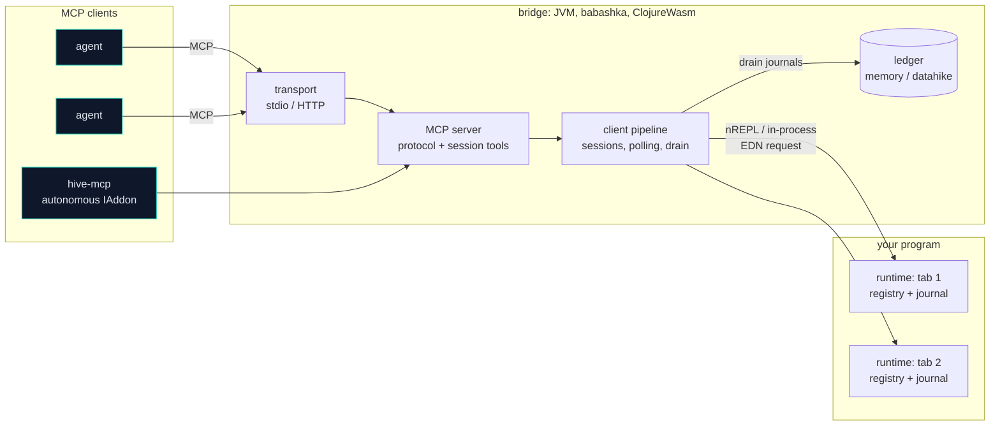

# Architecture

`autonomous` is built in strata. Pure value objects and decisions sit at the
bottom; state, sockets and REPLs sit at the edges, behind small ports. Each
stratum depends only on the ones below it.

## Picture



One call, end to end:

```
agent  --tools/call todo_add {"text":"milk"}-->  MCP server
MCP server: built-in tool? no -> client/call!
client: stamp session actor + scopes, send {:op :call ...} to the attached runtime
channel (nREPL :shadow): (shadow.cljs.devtools.api/cljs-eval :app "(autonomous.core/rpc-str \"...\")" {:runtime-id 3})
runtime: rpc -> plan-call (pure) -> middleware -> invoke-kind :re-frame/event -> dispatch-sync
runtime: journal {:kind :autonomous/call :actor ... :outcome :ok}, answer {:ok [...todos]}
client: Pending? poll with backoff; then drain the journal into the ledger in the background
MCP server: CallToolResult {content, structuredContent}
```

## Strata

| stratum | namespaces | role |
|---|---|---|
| domain (pure, cljc) | `autonomous.domain.schema`, `naming`, `scope`, `lease`, `journal`, `wire`, `answer`, `affordance`, `decision`, `manifest` | the ubiquitous language as malli schemas; tool names; scope algebra; lease rules; the journal ring; values that cross a bridge; the Ok / Pending / Refusal answer; compiling author specs into tools; planning a call; projecting a manifest for a grant |
| runtime (cljc) | `autonomous.runtime.registry`, `invoke`, `rpc`; facade `autonomous.core` | the only state (one atom); the invocation pipeline with its open `invoke-kind` multimethod; `rpc` / `rpc-str`, the one entry every bridge evaluates, which never throws |
| adapter (cljs + cljc) | `autonomous.re-frame`, `autonomous.re-frame.model` | events and subscriptions as tools, app-db as a resource, event origin in the journal; the pure half is `.model` |
| bridge | `autonomous.bridge.port`, `schema`, `session`, `auth`, `client`, `endpoint`, `eval-source`, `channel`, `nrepl`, `nrepl-wire`, `local`, `ledger`, `ledger.memory`, `ledger.datahike` | ports; value objects of the bridge; sessions; bearer tokens; the client pipeline; nREPL port discovery; request source text and its parsing; channel adapters; ledger adapters |
| MCP | `autonomous.mcp.protocol`, `json`, `builtins`, `server`, `stdio`, `http`, `http.start`, `http.jdk`, `http.kit` | JSON-RPC mapping as pure functions; JSON codec; the session tools as data; the server pipeline; stdio and HTTP transports with JDK and http-kit socket adapters |
| entry | `autonomous.config`, `autonomous.cli` | collect (file, env, args) and promote (merge, derive the target, validate) the configuration; `serve` and `token` |
| hive (separate module, `hive/`) | `autonomous.hive.addon`, `autonomous.hive.apps` | the `autonomous` IAddon for hive-mcp |

Within a stratum the code follows one shape: **collect** the inputs (read a
snapshot, a file, the environment), **promote** them with pure functions (a
plan, a validated config), run the **pipeline**, and keep effects at the
**boundary** (the registry atom, a socket, a REPL). The decision about a call,
`autonomous.domain.decision/plan-call`, is a pure function of a registry
snapshot, the args, the grant and the time.

## Ports

The client pipeline (`autonomous.bridge.client`) depends on three protocols
only, in `autonomous.bridge.port`. Every method answers an Answer map; a
transport failure is a refusal whose type is namespaced `:channel/*`, never an
exception.

| port | method | adapters |
|---|---|---|
| `IRuntimeChannel` | `-send request runtime-id` | `NreplChannel` (JVM, `nrepl.core`), `WireChannel` (babashka and ClojureWasm, bb-mcp's bencode client), `LocalChannel` (in process) |
| `IRuntimeDirectory` | `-runtimes` | the same three |
| `ILedger` | `-append! entries`, `-query q` | memory, datahike |

`autonomous.bridge.channel/make` picks the channel by `:target/kind`, and
reader conditionals pick the nREPL adapter per runtime. Requests travel as
printed EDN even in process, so the local path exercises the same wire as a
remote one.

## Runtimes the bridge runs on

One source tree serves MCP on three hosts:

| host | stdio | HTTP | nREPL channel | datahike ledger |
|---|---|---|---|---|
| JVM (`clojure -M:serve`) | yes | JDK `HttpServer` | `nrepl.core` | yes (`:datahike` alias) |
| babashka (`bb serve`) | yes | http-kit | bb-mcp bencode | no |
| ClojureWasm (`cljw -cp <classpath> -m autonomous.cli serve`) | yes | no, answers a refusal | bb-mcp bencode | no |

HTTP and token minting load on demand, so stdio serving on ClojureWasm needs
neither an HTTP server nor hashing.

The in-app runtime is `.cljc` and depends on malli only. It runs in a browser,
in node and on the JVM.

## Dependencies

| part | depends on |
|---|---|
| runtime (ships in your app) | malli |
| bridge (JVM) | malli, `org.clojure/data.json`, `nrepl/nrepl` |
| bridge (babashka) | malli, bb-mcp |
| re-frame adapter | re-frame and reagent, from your app |
| datahike ledger | `io.replikativ/datahike`, alias `:datahike` |
| hive addon | hive-addon, in the separate `hive/` module |

The core never depends on hive. It ships inside third-party browser bundles,
so it carries no hive runtime libraries.

## Tests

| suite | command | runs |
|---|---|---|
| JVM unit (runtime) | `clojure -M:test unit` | the runtime suites |
| JVM unit (bridge) | `clojure -M:dev/local:test unit` in `bridge/` | the bridge suites but `^:integration` |
| babashka | `bb test` | the decision, rpc and re-frame model suites |
| ClojureScript | `clojure -M:cljs -m shadow.cljs.devtools.cli compile test && node target/cljs-test/test.js` | the re-frame adapter |
| integration | `clojure -M:dev/local:test integration` in `bridge/` | the live swarm test (see [swarms.md](swarms.md)) |

`:dev/local` comes from the `-Sdeps` in the README's Develop and test section.

Most suites are trifectas (golden, property and mutation tests) built with
hive-test, a test-only dependency; the golden files live under `test/golden/`.
