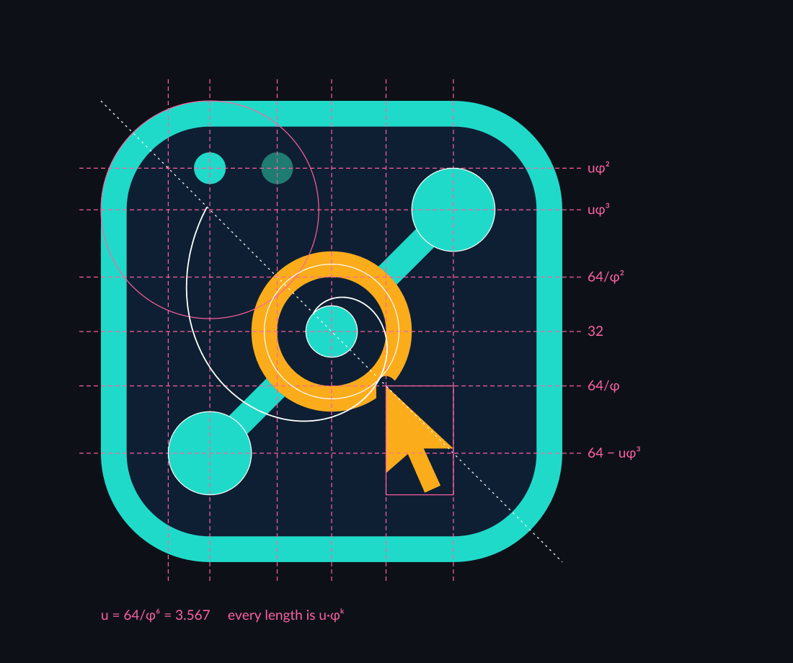

# Logo construction

The mark is an app window holding a small tool graph: two teal nodes on one
diagonal edge, an amber orbit ring round the active node in the middle, and an
amber agent cursor resting on that orbit. The window is the app, the graph is
its declared tools, the cursor is the agent operating them.

## One unit

The mark is drawn in a 64 x 64 viewBox, and 64 = u * phi^6, so

    u = 64 / phi^6 = 3.567        phi = 1.618

Every length in the mark is u * phi^k for a whole (or half) k:

| k | u * phi^k | used for |
|---|---|---|
| -2 | 1.36 | cursor halo (half of its stroke) |
| -1 | 2.20 | title-bar dot radius |
| 0 | 3.57 | frame stroke, edge stroke, orbit stroke, active-node core radius |
| 1 | 5.77 | end-node radius |
| 2 | 9.34 | orbit ring radius, title-bar row (y) |
| 3 | 15.11 | corner radius, cursor height, margin lines, first dot (x) |
| 4 | 24.45 | second dot (x), upper golden line |
| 5 | 39.55 | lower golden line, cursor tip |

The radii form one phi sequence: core u, end node u * phi, orbit u * phi^2.
The cursor is a golden rectangle: height u * phi^3, width that height / phi.

## Positions

- The two end nodes sit where the margin lines u * phi^3 and 64 - u * phi^3
  cross, so the edge runs corner to corner along the 45 degree diagonal.
- The active node sits at the centre (32, 32), on the same diagonal.
- The cursor tip sits on the lower golden point (64/phi, 64/phi) = (39.55,
  39.55). Its distance from the centre is 10.68, inside the orbit's stroke band
  (9.34 +/- 1.78), so the agent touches the ring it orbits.
- The golden spiral r = u * phi^(2 theta / pi) drawn on the overlay leaves the
  core (radius u) and crosses the orbit (u * phi^2) after half a turn, at the
  cursor: the agent's path is one quarter-growth spiral out of the node it acts on.
- The title-bar dots sit on the row y = u * phi^2, at x = u * phi^3 (the margin
  line) and x = u * phi^4 (the upper golden line).

## Lockup

With the mark height M = 64:

- wordmark cap height = M / phi^2 = 24.45
- gap from mark to wordmark = M / phi^3 = 15.11
- the wordmark x-height is centred on the mark's centre line
- clear space round the lockup = M / phi^4 = 9.34

The wordmark is Lato Bold converted to outlined paths, so no font file is
needed. The social preview uses the same lockup at mark height 640 / phi^3,
centred on the upper golden line of the card (y = 640 / phi^2), with the
tagline on the lower one (y = 640 / phi).

## Palette

Two brand hues and a neutral family, tuned in OKLCH.

| role | hex | OKLCH (L, C, h) |
|---|---|---|
| teal, the app and its tools | `#20dac9` | 0.80, 0.137, 185 |
| amber, the agent | `#faac1b` | 0.80, 0.164, 75 |
| tile / ink, navy | `#0f1f33` | 0.24, 0.044, 255 |
| ink on dark | `#e3e8f0` | 0.93, 0.012, 255 |
| dim teal, second dot | `#1e7c72` | 0.53, 0.085, 185 |
| social background | `#06101c` to `#102034` | 0.17 to 0.24, hue 255 |

Why these: the neutrals sit on hue 255, which is the complement of the amber
(75 + 180). Teal (185) is a near neighbour of that blue, so the set is a
split complement: a cool app family (navy and teal) and one warm accent for
the agent, which is the thing the eye should find. Teal and amber share the
same OKLCH lightness (0.80), so neither hue outshouts the other and both hold
the same contrast against the navy. Chroma is set to 97 percent of the sRGB
gamut limit at that lightness and hue.

## Contrast (WCAG 2)

| foreground | on white | on #0d1117 | on tile #0f1f33 | on social #06101c | on social #102034 |
|---|---|---|---|---|---|
| teal | 1.76 | 10.75 | 9.44 | 10.86 | 9.34 |
| amber | 1.91 | 9.90 | 8.69 | 10.00 | 8.59 |
| tile / ink | 16.61 | 1.14 | 1.00 | 1.15 | 1.01 |
| ink on dark | 1.23 | 15.38 | 13.50 | 15.53 | 13.35 |
| dim teal | 5.02 | 3.77 | 3.31 | 3.81 | 3.27 |
| tagline grey `#adb9c8` | 1.99 | 9.51 | 8.35 | 9.60 | 8.25 |

Teal and amber never sit on white directly: they always sit on the navy tile
(8.7 and 9.4). On white the navy tile carries the mark (16.6); on GitHub dark
the teal frame outlines it (10.8), so the mark needs no theme switch. Only the
wordmark switches, through `prefers-color-scheme` in `logo.svg`, and the two
README heroes bake each colour in. The dim second dot is a deliberate low
contrast detail (3.3 on the tile) and carries no meaning.

## Sizes

Checked at 16, 32, 64, 256 and 512 px through librsvg (resvg) and GIMP. At
32 px every part keeps its own pixels: frame, both dots, the two nodes, the
ring with its core, and the cursor. At 16 px the frame, nodes, core and ring
read; the cursor shrinks to a few amber pixels.

## Files

- `doc/mark.svg`: square mark, 64 viewBox (favicon, avatar)
- `doc/logo.svg`: mark plus wordmark, theme-aware wordmark colour
- `doc/img/hero-light.png`, `doc/img/hero-dark.png`: 840 x 240 lockups
- `doc/img/favicon-32.png`, `doc/img/mark-512.png`
- `doc/img/social-preview.png`: 1280 x 640 GitHub social preview
- `doc/img/logo-construction.png`: the overlay above
